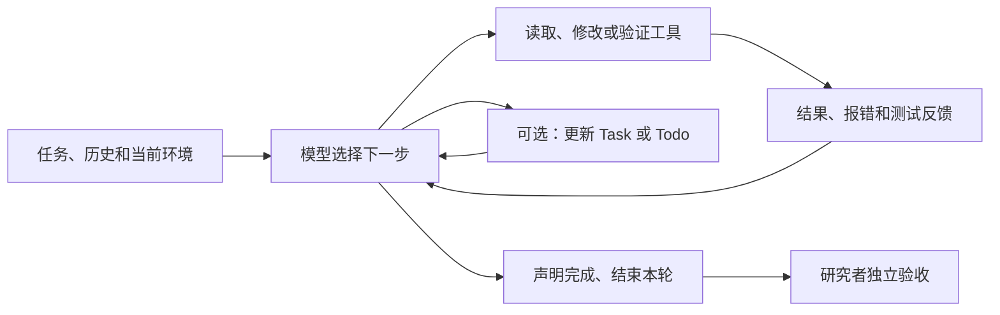

**四个系统在 Stage A 中的规划行为比较**

这轮记录支持的核心结论是：四者都表现为“读取任务与环境 → 选择下一步行动 → 调用工具 → 根据结果继续或修正 → 验证并结束”的循环。主要区别在于是否维护结构化任务状态、如何组织工具调用、如何处理失败反馈，以及验证到什么程度才结束。现有证据没有显示四套不同的独立 planner 算法，也不足以还原模型内部的搜索或推理机制。

本文分析已有日志和验收产物，没有重新运行被测 agent 或验收器。新增文件仅为本报告和 [结构化证据索引](/Users/mingshi/Desktop/planner_probe_v1/researcher/analysis/stage_A_planner_evidence.json)。索引记录工具调用、原始日志行号和 68 个输入文件的 SHA-256；生成时核对了输入未被改变，并确认四个工作区中对应文件与各自 code-A.zip 快照逐字节一致。未把日志中的 thinking 文本当作完整内部机制的证据。

**观察条件与结果**

四个系统收到同一句任务指令 `Complete the task in TASK.md.`，完成同一份 agentstats 修复与扩展任务：修正 token 计数、任务与调用去重，增加分组与 CSV 输出，保留原有命令并增加测试。这里分析的是 `natural_01` 的 Stage A，未包含独立 Plan 模式对照或 Stage B 需求变更。

| 系统 | 本轮模型与运行身份 | 显式任务管理 | 最终自身测试 | 已保存的独立验收 |
|---|---|---|---:|---:|
| Claude Code | 日志 `claude-opus-5`；CLI 2.1.267 | 无专门任务工具调用；用文字说明阶段 | 25 | 18/18，通过 |
| Codex | `gpt-6-astra`、`max`；CLI 0.154.0，`codex exec` | 无 `update_plan` 等计划工具调用；用文字说明阶段 | 29 | 18/18，通过 |
| Qoder | 日志 `qmodel_38max`；截图显示 Qwen3.8-Max；CLI 1.1.53 | 4 次 `TaskCreate`、6 次 `TaskUpdate` | 48 | 18/18，通过 |
| DeepSeek Harness | `deepseek-official / deepseek-flash`、`high`；standard preset | 5 项 Todo，2 次 `todo_write` | 47 | 18/18，通过 |

DSH 的本机缓存包版本为 0.1.5-rc.1；会话本身未独立记录 CLI 版本，不能把缓存版本当作严格的运行版本证明。各模型名称按日志原值记录。

18/18 是同一个任务的 18 个验收检查，不是完成了 18 个独立任务。各自编写的 25、29、48、47 个测试覆盖范围不同，不能按数量给 planner 排名。验收依据：[Claude](/Users/mingshi/planner_probe_runs/claude/natural_01/records/grade-A.json)、[Codex](/Users/mingshi/planner_probe_runs/codex/natural_01/records/grade-A.json)、[Qoder](/Users/mingshi/planner_probe_runs/qoder/natural_01/records/grade-A.json)、[DSH](/Users/mingshi/planner_probe_runs/deepseek/natural_01/records/grade-A.json)。

**先把 planner 分成三层理解**

1. **模型决策层**：理解要求，判断还缺什么信息，选读文件、改代码、跑测试或结束。日志能显示选中的行动，不能显示模型是否在内部比较过其他路线。
2. **任务状态层**：把子任务和状态写入 Task/Todo。它能帮助保存和展示进度，但列表本身不等于一个独立的搜索或调度算法。
3. **执行框架层**：提供工具、权限、文件访问约束、历史记录和循环控制。相同的意图放在不同工具约束下，会产生不同的调用轨迹。

这是对本轮行为的抽象。Claude 和 Qoder 的官方说明也将 agent 描述为模型与工具反馈反复交互的循环；Qoder 说明模型根据返回结果决定是否继续。[Claude 官方说明](https://code.claude.com/docs/en/how-claude-code-works)、[Qoder 官方说明](https://docs.qoder.com/cli/how-it-works)。下面的具体判断以本地实际轨迹为准。

**Claude Code：分阶段推进，并检查验证过程自身的质量**

它先读取任务、源码、原有测试和样例，再运行原有测试，看到 9 项中 3 项失败。随后依次修改 records、report、cli，原有 9 项测试通过后，使用临时脚本独立重算样例，再补充新测试、检查边界情况并更新 README。这里的“独立重算”是同一个 agent 另写一套计数逻辑，不是外部研究者验收。[原始测试与诊断](/Users/mingshi/.claude/projects/-Users-mingshi-planner-probe-runs-claude-natural-01-workspace/12e21530-1258-4d5b-9dc2-bf8eb336c291.jsonl:71)、[独立核算调用](/Users/mingshi/.claude/projects/-Users-mingshi-planner-probe-runs-claude-natural-01-workspace/12e21530-1258-4d5b-9dc2-bf8eb336c291.jsonl:98)。

这轮没有 Task/Todo 调用。8 次 Read 用于读取文件，20 次 Bash 承担命令执行和全部文件修改；写文件主要通过 shell 和 Python 脚本完成。阶段划分体现在进度说明和实际动作顺序中，没有单独持久化的任务清单。

最有辨识度的是两次针对测试自身的调整。生成测试时，字符串转义错误导致 `SyntaxError`，它读取相关代码并修复。下一次输出是 **64 项测试全部通过**，它仍发现测试类继承使原有用例被重复运行，于是抽取共享测试基类，把结果修正为 **25 项不同测试通过**。这说明本轮结束判断不仅依赖绿色结果，还包含对测试组织是否合理的检查。[语法错误结果](/Users/mingshi/.claude/projects/-Users-mingshi-planner-probe-runs-claude-natural-01-workspace/12e21530-1258-4d5b-9dc2-bf8eb336c291.jsonl:109)、[64 项通过](/Users/mingshi/.claude/projects/-Users-mingshi-planner-probe-runs-claude-natural-01-workspace/12e21530-1258-4d5b-9dc2-bf8eb336c291.jsonl:125)、[随后修正测试结构](/Users/mingshi/.claude/projects/-Users-mingshi-planner-probe-runs-claude-natural-01-workspace/12e21530-1258-4d5b-9dc2-bf8eb336c291.jsonl:129)。

它也遇到 macOS 的 `cat -A` 不兼容，随后改用可用命令。这是环境适配，与任务整体重规划不同。最终完成声明有一个计数笔误：写成“9 original + 13 new = 25”；日志与当前测试定义均支持总数 25，新增应为 16。结论应采用实际结果而不是照抄总结。

可概括为：**文字表达阶段目标 → 按模块实现 → 独立核算 → 扩充测试 → 修正测试与检查边界 → 结束**。观察到了局部纠错，没有观察到整体任务分解被推翻或替换。

**Codex：批量收集信息、集中修改，再做契约验证**

成功运行是 `codex-A-retry2.jsonl`。之前两份记录是 CLI 与模型兼容问题，不是进入任务后规划失败；不能把它们算成两次代码任务失败。[成功记录](/Users/mingshi/planner_probe_runs/codex/natural_01/records/codex-A-retry2.jsonl)。

它先读取 TASK 和工作区指令，收集代码、README、测试与样例，再运行原有测试，确认 3 个计数问题。随后第一批补丁修改实现和 README，第二批补丁补充边界处理与契约测试；新增测试完成后的第一次全套执行即为 **29 项通过**，之后检查 diff 与 CLI 帮助并结束。[问题诊断](/Users/mingshi/planner_probe_runs/codex/natural_01/records/codex-A-retry2.jsonl:20)、[第二批修改前的阶段说明](/Users/mingshi/planner_probe_runs/codex/natural_01/records/codex-A-retry2.jsonl:23)、[测试结果](/Users/mingshi/planner_probe_runs/codex/natural_01/records/codex-A-retry2.jsonl:29)。

原始日志里有 8 次 `exec` 调度，内部包含 11 次 `exec_command` 和 2 次 `apply_patch`。其中 4 次通过 `Promise.allSettled` 批量调度独立工作，例如同时读不同材料、同时跑测试与检查差异。这里是并行工具调用，没有观察到并行子 agent 或独立 planner agent。[批量读取](/Users/mingshi/.codex/sessions/2026/09/15/rollout-2026-09-15T20-24-49-01a0a79a-1a1a-7d90-9cba-4afae6c01d38.jsonl:28)、[测试与差异检查批次](/Users/mingshi/.codex/sessions/2026/09/15/rollout-2026-09-15T20-24-49-01a0a79a-1a1a-7d90-9cba-4afae6c01d38.jsonl:77)。

这轮没有专门计划工具调用，但存在明确的阶段说明与动作衔接。验证主要组织在新增的 20 个契约测试中，包括硬编码样例期望值、JSON/CSV 一致性和输入边界；未观察到与另外三者相同的单独临时脚本重算样例路线。它也曾用 `cat fixtures/*` 碰到目录，随后读取嵌套文件；这是局部读取调整。

可概括为：**批量读取 → 用现有失败定位 → 两批集中修改 → 契约测试和差异检查 → 结束**。这条轨迹中的修改后测试回路较少，但不能由此认定其 planner 更强或没有其他推理开销。运行指令本身包含独立操作并行化等要求，所观察到的行为包含提示词与工具环境的影响。

**Qoder：显式任务管理，加上较细的实现与验证迭代**

最重要的记录差异是：`qoder-A.txt` 没有保留任务管理事件，原始 JSONL 中实际有 **4 次 TaskCreate 和 6 次 TaskUpdate**。只看终端导出，会把它错误归为“没有显式计划”。四个任务分别是：修复计数与去重、增加分组、增加 CSV 与 CLI 行为、补测试和核算并更新 README。[四个任务的创建](/Users/mingshi/.qoder/projects/-Users-mingshi-planner-probe-runs-qoder-natural-01-workspace/d2178ce7-b523-48f7-8c8b-a5dfed9fc24e.jsonl:57)。

这些任务是在读取源码与样例后创建的。它先写实现，跑原有 9 项测试通过，然后把 Git HEAD 的原版提取到临时目录，补做“原版 3 项失败”的对照。因此，Qoder 本轮的初始实现不是由它自己先跑出的失败测试触发，而是先依据任务和代码作出修改，再追溯验证原版问题。[首次修改后的测试](/Users/mingshi/.qoder/projects/-Users-mingshi-planner-probe-runs-qoder-natural-01-workspace/d2178ce7-b523-48f7-8c8b-a5dfed9fc24e.jsonl:100)、[原版对照调用](/Users/mingshi/.qoder/projects/-Users-mingshi-planner-probe-runs-qoder-natural-01-workspace/d2178ce7-b523-48f7-8c8b-a5dfed9fc24e.jsonl:107)。

它另写脚本独立核算样例，也检查 CSV 与错误路径。在一次临时检查和后来新增的一个测试中，它错误地期待 overall 报告包含具体模型名；契约要求 overall 的模型/benchmark 字段为空。它重新检查要求，把验证切换到 grouped 报告，修正断言，而不是修改正确的产品行为去迎合错误测试。期间还修复了一次编辑造成的重复测试定义，最终 48 项通过。[新增测试失败](/Users/mingshi/.qoder/projects/-Users-mingshi-planner-probe-runs-qoder-natural-01-workspace/d2178ce7-b523-48f7-8c8b-a5dfed9fc24e.jsonl:175)、[修正测试](/Users/mingshi/.qoder/projects/-Users-mingshi-planner-probe-runs-qoder-natural-01-workspace/d2178ce7-b523-48f7-8c8b-a5dfed9fc24e.jsonl:179)。

第一次 48 项通过后，它继续检查 `read_records` 的直接返回行为，修正该层 `duplicate_records` 仍为固定值的问题，并将任务身份 helper 共享给报告模块，再跑回归。说明它本轮的结束判断也包括函数语义与代码一致性检查。[通过后继续修改读取层](/Users/mingshi/.qoder/projects/-Users-mingshi-planner-probe-runs-qoder-natural-01-workspace/d2178ce7-b523-48f7-8c8b-a5dfed9fc24e.jsonl:219)。

任务状态并未精确驱动每一个动作：任务 1 先进入进行中，任务 1、2、3 随后被一起标记完成，任务 4 进入进行中；后面仍继续修改前面任务涉及的实现，没有重新打开任务 1。整个列表的四项目标也没有被重写。这更像分阶段进度记录，未显示任务依赖图自动调度或失败后重新生成整体计划。[中途状态更新](/Users/mingshi/.qoder/projects/-Users-mingshi-planner-probe-runs-qoder-natural-01-workspace/d2178ce7-b523-48f7-8c8b-a5dfed9fc24e.jsonl:153)。

可概括为：**读代码后建四项任务 → 实现与独立核算 → 修正错误验证 → 通过后继续检查接口语义 → 完成任务状态**。工具使用较细：10 Read、16 Bash、3 Write、13 Edit，以及 10 个任务管理调用；也出现同一批次发出多个读取/检查调用，不能简单把它归为完全串行。

**DeepSeek Harness：按模块列 Todo，工具约束影响执行路径**

这份日志完整记录了 28 个 assistant 步骤：前 27 步各调用一个工具，最后一步给出完成答复。它读取任务、源码和样例后，在第 5 步创建五项 Todo，依次覆盖 records、report、cli、测试与 README、最终验证。[原始会话包](/Users/mingshi/planner_probe_runs/deepseek/natural_01/records/dsh-session-session-acd72d86-ae85-47f6-a580-28637f2929e3.zip)，成员 `session.v3.jsonl` 第 38 行（seq 36）。

虽然第 3 步已通过 bash 输出过源码，第 6 步写 records.py 时仍被工具拒绝：文件没有通过受追踪的读取过程。第 7 步调用 read 后，第 8 步写入成功；随后 report、cli 也先 read 再 write。这个顺序由模型适应框架约束形成，不能简单解释成它主动选择了更谨慎的阅读策略。证据是会话第 44–54 行，以及本机文件工具中对应的 [错误处理实现](/Users/mingshi/.npm/_npx/1e7f6d9597241db0/node_modules/@deepseek-ai/dsh-tool-fs/lib/index.js:545)。

它改完三个模块后才第一次跑原有测试，9 项通过。接着临时独立核算样例，但脚本误把 grouped 输出的第一行与 overall 总数比较，得到 `completed_tasks: 2 != 26`。下一步修正核算脚本，分别比较 overall 和 grouped，两种输出及 CSV 回读通过；这两步之间没有修改产品实现。这里观察到的是验证错误的定位，不是产品计数失败。证据为会话第 89、90、94、95 行（步骤 15–16）。

新增 38 个测试后，总计 47 项通过。它随后补充了直接接受字符串形式 group_by 的处理，README 还记载并实际演示了单键分组。这部分超出了任务明示的两个必需模式，反映出本轮会顺手扩展能力；不能把额外功能本身计为更好的规划。最终重跑 47 项测试并检查边界情况，然后一次性把五项 Todo 全部标成完成。

Todo 只更新了两次：第 5 步创建“1 进行中、4 待办”，第 26 步改成“5 完成”。内容与顺序没有重写，也没有逐项推进状态。因此，本轮 Todo 是粗粒度进度记录，没有体现持续更新的执行状态机。

这一点还能得到源码支持：`todo_write` 的执行函数校验条目，把完整列表写入会话，返回状态数量；它不执行代码任务、不选择下一个工具，也不检验任务是否真的做完。[Todo 执行函数](/Users/mingshi/.npm/_npx/1e7f6d9597241db0/node_modules/@deepseek-ai/dsh-tool-todo/lib/index.js:170)。模型—工具循环在另一个模块中；其步骤逻辑在模型没有发出工具调用时可返回 completed，外层另有停止扩展点。因此 completed 是生命周期状态，并不自带本实验的 18 项验收。[循环实现](/Users/mingshi/.npm/_npx/1e7f6d9597241db0/node_modules/@deepseek-ai/dsh-agent-loop/lib/index.js:1108)。这些是本机缓存实现与日志行为的相互印证，不推广为所有版本的机制。

可概括为：**读代码后列五项 Todo → 逐模块读写 → 独立核算与纠错 → 补测试及少量扩展 → 批量完成 Todo → 展示文件并结束**。本次轨迹是串行单工具调用；框架源码本身支持并行安全工具的并发执行，不能把本次串行观察写成框架只支持串行。

**共同点，以及真正值得比较的差异**

四者的共同点有五个：先获取项目证据再实施；围绕读取/统计/CLI/测试拆解同一要求；用工具把判断转成实际修改与验证；结合工具反馈继续行动；在自身验证后给出完成声明。它们都使用一个可见的主会话推进任务，未观察到显式委派给独立 planner 或 executor 的子 agent，也未观察到显式树搜索或多候选方案比较。

| 比较维度 | 本轮可确认的差异 | 对 planner 的意义 |
|---|---|---|
| 计划如何外显 | Claude/Codex 用阶段文字；Qoder 用四项 Task；DSH 用五项 Todo | 计划的表示与持久化方式不同，不等于规划能力有无 |
| 修改前是否验证原版 | Claude/Codex 先看到 3 项失败；Qoder 改后补做原版对照；DSH 没有运行原版测试 | 区分反馈驱动定位与先读代码实施，不能只比较最终都跑过测试 |
| 行动怎样组织 | Codex 多次批量调度并集中 patch；Claude 主要 Bash 写文件；Qoder 多次 Edit；DSH 本轮逐步调用 | 调度、工具粒度和权限共同塑造轨迹 |
| 怎样建立可信结果 | 三者另写临时计数逻辑；Codex 主要通过契约测试固定期望并验证一致性 | 属于验证路线差异，不能直接等同于成本高低 |
| 怎样应对失败 | Claude 修测试生成与重复执行；Qoder 修错误断言并补接口语义；DSH 适应读取约束、修核算脚本；Codex 改后测试直接通过 | 失败要按环境、实现、验证三类区分，不能统一计为“重规划次数” |
| 任务状态是否控制执行 | Qoder 的已完成项之后仍有相关修改；DSH 从初始列表直接跳到全部完成 | 任务清单不构成严格调度或正确性保证 |
| 何时停止 | 四者都在多种自身检查后停止，随后已有研究者独立验收 | 模型完成、框架结束、独立验收是三个不同事件 |

“局部纠错”和“整体重规划”需要分开。本轮看到了修正命令、重新读取、修改测试和替换核算脚本；没有充分证据表明某个系统因新信息重新设计了整体任务分解、重排依赖或放弃原路线。这项任务足够小且要求明确，观察到的主要是执行循环与局部调整。

**现有数据不能支持的结论**

- 不能从未调用计划工具推断 Claude/Codex 没有 planner，也不能从 Task/Todo 推断 Qoder/DSH 有独立规划模型。
- 不能把“Qoder 52 次工具调用”与“Codex 8 次 exec”直接比较。后者封装了 13 个执行/补丁调用，一个命令又可以包含多项动作；Qoder 的 52 次中有 10 次是任务状态工具。工具数不是推理轮数或 token 成本。
- 不能按自身测试数或这次用时排名。四个后端模型、推理设置、工具与权限不同；Claude 记录了 default → auto 的权限变化，Codex 是 workspace-write/never。Qoder 某次工具发出与返回之间约隔 5 分钟，日志不能直接解释该间隔。墙钟时间混合了等待与执行。
- 四者在此任务都通过验收，只有各一次自然条件记录，缺乏任务难度与重复次数，无法估计稳定性或归因某个 planner 的优劣。
- 样例结果里的 17,680 tokens 是 agentstats 处理的数据，不是四个被测 agent 的消耗。真实 usage 的缓存、输入与输出字段口径还需单独核对，不能用样例总数、导出大小或工具数替代。

因此，这轮最有价值的研究结论是：**四者共享一个可观察的模型决策—工具执行—反馈循环；显式任务表、工具调度、验证路线和框架约束构成了不同的外部规划行为。Task/Todo 的存在与更新次数，无法单独说明内部规划深度或任务正确性。**

如果后续需要研究“整体重规划”，已有 Stage B 的统一需求变更适合作为下一种观察条件；需要分别记录旧计划如何改变、旧行为如何回归、新要求是否通过独立验收。若要研究某种规划方法是否更省 token，则应固定模型与框架，在相同任务上比较有/无显式任务表或不同验证路线，并进行重复试验；本次分析没有执行这些扩展实验。

**复核用计数**

| 系统 | 完整轨迹中的工具计数 | 实际测试套件执行次数 |
|---|---|---|
| Claude | Read 8；Bash 20；共 28 | 6：原版 9 项/3 失败 → 修改后 9 通过 → 测试导入错误 → 64 通过但有继承重复 → 25 通过 → 25 通过 |
| Codex | exec 8；内部 exec_command 11、apply_patch 2；4 个并行批次 | 2：原版 9 项/3 失败 → 29 通过 |
| Qoder | Read 10；Bash 16；Write 3；Edit 13；TaskCreate 4；TaskUpdate 6；共 52 | 6：修改后 9 通过 → 临时原版 9 项/3 失败 → 48 项/1 失败 → 48 通过 → 48 通过 → 48 通过 |
| DSH | bash 10；read 6；write 6（含 1 次被拒绝）；edit 2；todo_write 2；present 1；共 27 | 3：修改后 9 通过 → 47 通过 → 47 通过 |

这里仅统计真实执行测试套件的命令，不把写入 README 的 unittest 示例当作测试执行，也不把独立核算脚本、CLI 探针或研究者验收计入该列。所有数量都只描述本次轨迹。
